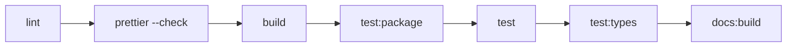
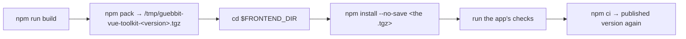

# Development

Working on the toolkit itself: the npm scripts, the quality gate, and how to try an unpublished
change in a real app.

## Scripts

| Script                                      | What it does                                                                                     |
| ------------------------------------------- | ------------------------------------------------------------------------------------------------ |
| `npm run complete`                          | **The quality gate.** `lint` → `prettier` (check) → `build` → `test:package` → `test` → `test:types` → `docs:build`. Changes nothing; fails on the first problem. Runs in the pre-commit hook, before `npm publish`, and in the release workflow. |
| `npm run complete:fix`                      | The same pipeline, but `lint:fix` and `prettier:fix` rewrite files instead of only reporting. Run it before committing to clean up. |
| `npm run build`                             | `tsc` into `dist/` (`prebuild` wipes `dist/` first).                                             |
| `npm test`                                  | Jest: examples, property-based tests, model tests and the browser-mode suite.                    |
| `npm run test:types`                        | Type-level tests of the public types (`tsc -p tsconfig.types.json`).                             |
| `npm run test:package`                      | Checks the built package: `publint`, `attw`, a smoke import of every export, and a guard that the `.d.ts` files reference nothing private. |
| `npm run test:mutation`                     | Stryker mutation testing. Slow; also a nightly CI job. `test:mutation:incremental` reuses the last run. |
| `npm run test:target`                       | Jest on `tests/structureRestApi` only (clears the terminal first).                               |
| `npm run lint` / `lint:fix`                 | ESLint (check / fix).                                                                            |
| `npm run prettier` / `prettier:fix`         | Prettier (check / write).                                                                        |
| `npm run docs:dev` / `docs:build` / `docs:preview` | VitePress: dev server on port 8080, production build, preview of the build.               |
| `npm run try:frontend`                      | Installs the packed toolkit into an app to try a change before publishing. See below.            |
| `npm run update:all`                        | `npm-check-updates -u`: bumps every dependency in `package.json`.                                |
| `npm run publish:public`                    | `npm publish --access public`. `prepublishOnly` runs `complete` first.                           |



`complete:fix` swaps the first two steps for their `:fix` versions; the rest is identical.

## Trying a change in an app before publishing

`npm run try:frontend` installs the **packed toolkit** into another project, so you can run that
project's own checks against code that is not on npm yet.

```bash
# in vue-toolkit
npm run try:frontend                          # target: ../boilerplate-vue-frontend
FRONTEND_DIR=../my-app npm run try:frontend   # any other app

# in the app: run its checks (tests, type-check, a manual look), then
npm ci                                        # back to the published version
```



Why a tarball and not `npm link` or a `file:` dependency:

- **It is exactly what `npm publish` ships** (`files`, `exports`, the `.d.ts`), so a packaging
  mistake shows up here and not after the release.
- **A symlink breaks the peers.** `vue`, `pinia` and `@tanstack/vue-query` would resolve from this
  repo's own `node_modules`: two copies of Vue in one app, and `inject()` / Pinia silently stop
  working.
- **`--no-save` leaves the app's `package.json` and lockfile alone**, so nothing leaks into one of
  its commits. A later plain `npm install` in the app drops the tarball: run `try:frontend` again.

## The docs site

The VitePress site (`docs/`) reads `version` from `package.json` at build time: the nav's version
menu, the home page footer and every page's "last updated" line show it, so a release bump is all
it takes. The `/changelog` page includes the root `CHANGELOG` file as-is.

"Last updated" is each page's last git commit. A build from a shallow clone sees one commit for
every page, so the docs deploy has to check out the full history (`fetch-depth: 0`).
