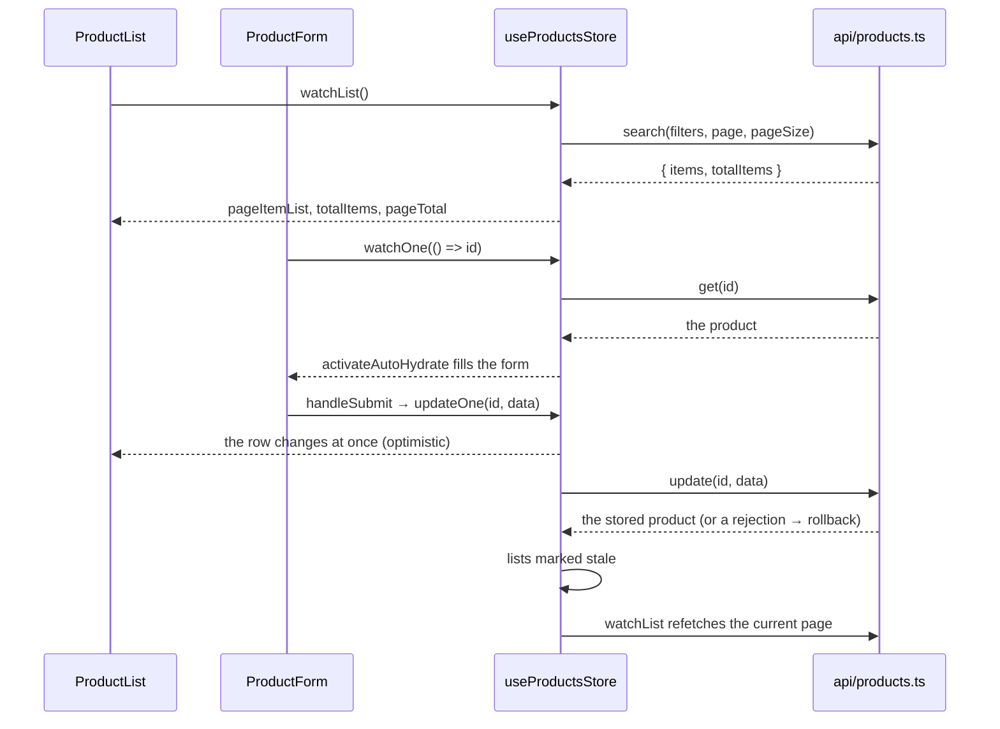

# Your first CRUD screen

A products screen, end to end: a searchable, paginated list with delete, and a create/edit form
with validation and server-side errors. Plain HTML elements throughout — swap in your UI kit's
components where you like.

```text
src/
├── main.ts                 app setup: Pinia + VueQueryPlugin
├── types/product.ts        the record, the filters, the write payload
├── api/products.ts         one function per endpoint
├── stores/products.ts      the resource: useStructureCrudApi in a Pinia setup store
└── components/
    ├── ProductsPage.vue    list + form, side by side
    ├── ProductList.vue     search, pages, delete
    └── ProductForm.vue     create / edit, with useStructureFormValidation
```

How the pieces talk to each other:



## 1. App setup

```ts
// src/main.ts
import { createApp } from 'vue'
import { createPinia } from 'pinia'
import { QueryClient, VueQueryPlugin } from '@tanstack/vue-query'
import App from './App.vue'

// One client per app: every resource lives in it, which is what lets them invalidate each other.
const queryClient = new QueryClient()

const app = createApp(App)
app.use(createPinia())
app.use(VueQueryPlugin, { queryClient })
app.mount('#app')
```

What the client's `defaultOptions` change (retries, offline behaviour) is on
[Getting Started](/guide/getting-started#app-setup).

## 2. Types

```ts
// src/types/product.ts

/** A product, as the API returns it. */
export interface IProduct {
    id: string
    title: string
    price: number
}

/** What the search form edits. */
export interface IProductFilters {
    text: string
}

/** What create and update send: everything but the id. */
export type TProductInput = Omit<IProduct, 'id'>
```

`IProduct` has an `id` field, so the resource's id type (`K`) is inferred as `string`.

## 3. API functions

One plain function per endpoint, here on `fetch`. The toolkit never sees your HTTP client: it only
calls these.

```ts
// src/api/products.ts
import type { ISearchResult } from '@guebbit/vue-toolkit'
import type { IProduct, IProductFilters, TProductInput } from '../types/product'

const BASE = '/api/products'

/** Resolves the JSON body; rejects with it on an error status, so applyServerErrors can read it. */
const json = <R>(response: Response): Promise<R> =>
    response.ok
        ? (response.json() as Promise<R>)
        : response
              .json()
              .catch(() => ({}))
              .then((body) => Promise.reject(body))

/** JSON request options for a write. */
const send = (method: string, data: TProductInput): RequestInit => ({
    method,
    headers: { 'Content-Type': 'application/json' },
    body: JSON.stringify(data)
})

export const listProducts = (signal?: AbortSignal) =>
    fetch(BASE, { signal }).then((response) => json<IProduct[]>(response))

export const searchProducts = (
    filters: IProductFilters,
    page: number,
    pageSize: number,
    signal?: AbortSignal
): Promise<ISearchResult<IProduct>> => {
    const query = new URLSearchParams({ text: filters.text, page: `${page}`, pageSize: `${pageSize}` })
    return fetch(`${BASE}?${query}`, { signal })
        .then((response) => json<{ items: IProduct[]; total: number }>(response))
        .then(({ items, total }) => ({ items, totalItems: total }))
}

export const getProduct = (id: string, signal?: AbortSignal) =>
    fetch(`${BASE}/${id}`, { signal }).then((response) => json<IProduct>(response))

export const createProduct = (data: TProductInput) =>
    fetch(BASE, send('POST', data)).then((response) => json<IProduct>(response))

export const updateProduct = (id: string, data: TProductInput) =>
    fetch(`${BASE}/${id}`, send('PUT', data)).then((response) => json<IProduct>(response))

export const deleteProduct = (id: string) =>
    fetch(`${BASE}/${id}`, { method: 'DELETE' }).then((response) =>
        response.ok ? undefined : Promise.reject(response)
    )
```

The read functions take an optional `AbortSignal`: the toolkit hands one to every read, and
forwarding it cancels a request nothing needs any more (an unmounted list, a superseded search).

## 4. The store

```ts
// src/stores/products.ts
import { defineStore } from 'pinia'
import { useStructureCrudApi } from '@guebbit/vue-toolkit'
import type { IProduct, IProductFilters, TProductInput } from '../types/product'
import {
    createProduct,
    deleteProduct,
    getProduct,
    listProducts,
    searchProducts,
    updateProduct
} from '../api/products'

export const useProductsStore = defineStore('products', () => {
    // <record, id, filters, create payload, update payload>
    const api = useStructureCrudApi<IProduct, string, IProductFilters, TProductInput, TProductInput>(
        {
            // Reads receive a { signal } context as their last argument.
            list: ({ signal }) => listProducts(signal),
            search: (filters, page, pageSize, { signal }) =>
                searchProducts(filters, page, pageSize, signal),
            get: (id, { signal }) => getProduct(id, signal),
            create: (data) => createProduct(data),
            update: (id, data) => updateProduct(id, data),
            remove: (id) => deleteProduct(id)
        },
        {
            // First segment of every cache key: queryClient.invalidateQueries({ queryKey: ['products'] })
            resourceKey: 'products',
            initialFilters: { text: '' }
        }
    )

    return { ...api }
})
```

That is the whole resource: caching, request de-duplication, optimistic writes with rollback,
filters and server pagination. A real app usually also passes `dependsOn` (whose data, which
language) so one user's cache never shows for the next: see
[`dependsOn`](/composables/structure-rest-api#dependson).

## 5. The list

```vue
<!-- src/components/ProductList.vue -->
<script setup lang="ts">
import { storeToRefs } from 'pinia'
import { useNotificationsStore, EToastType } from '@guebbit/vue-toolkit'
import { useProductsStore } from '../stores/products'

const emit = defineEmits<{ edit: [id: string] }>()

const store = useProductsStore()
const notifications = useNotificationsStore()

// State through storeToRefs (keeps it reactive); methods straight from the store.
const { filters, pageItemList, pageCurrent, pageTotal, totalItems, isPlaceholder } = storeToRefs(store)

// The active search: page 1 now, then every page change and every invalidation (a save, a delete).
// It stops when this component unmounts. It never rejects: a failure shows in `error`.
const { error } = store.watchList()

/** A toast for a failed action; the list itself keeps showing what it had. */
const notifyError = (text: string) => () => notifications.addMessage(text, EToastType.DANGER, 5000)

/** The Search button: apply the edited filters from page 1. */
const search = () => store.searchNow().catch(notifyError('Search failed'))

/** The Reset button: back to the initial filters, asking the server again. */
const reset = () => store.resetFilters().catch(notifyError('Search failed'))

/** Delete: the row leaves at once, and comes back if the request fails. */
const remove = (id: string) => store.deleteOne(id).catch(notifyError('Could not delete the product'))
</script>

<template>
    <form @submit.prevent="search">
        <input v-model="filters.text" type="search" placeholder="Search products" />
        <button type="submit">Search</button>
        <button type="button" @click="reset">Reset</button>
    </form>

    <p v-if="error" role="alert">Could not load the products.</p>

    <!-- isPlaceholder: the previous page stays on screen, dimmed, while the next one loads -->
    <table :style="{ opacity: isPlaceholder ? 0.5 : 1 }">
        <tbody>
            <tr v-for="product in pageItemList" :key="product.id">
                <td>{{ product.title }}</td>
                <td>{{ product.price }}</td>
                <td>
                    <button type="button" @click="emit('edit', product.id)">Edit</button>
                    <button
                        type="button"
                        :disabled="store.isSaving(product.id)"
                        @click="remove(product.id)"
                    >
                        Delete
                    </button>
                </td>
            </tr>
        </tbody>
    </table>

    <p>{{ totalItems }} products</p>
    <button type="button" :disabled="pageCurrent <= 1" @click="pageCurrent--">Previous</button>
    <span>{{ pageCurrent }} / {{ pageTotal }}</span>
    <button type="button" :disabled="pageCurrent >= pageTotal" @click="pageCurrent++">Next</button>
</template>
```

- Typing in the search box fetches nothing: what is shown follows the **applied** search, which
  only `searchNow()`/`resetFilters()` change. See
  [Filters and when a search runs](/composables/structure-crud-api#filters-and-when-a-search-runs).
- `totalItems` and `pageTotal` come from the `search` operation's `totalItems`, and survive a
  cache hit.
- `store.isSaving(id)` is true while an update or delete of that row runs: a per-row spinner.

## 6. The form

One component for both create (no `id`) and edit (an `id`).

```vue
<!-- src/components/ProductForm.vue -->
<script setup lang="ts">
import { computed, ref } from 'vue'
import { z } from 'zod'
import {
    EToastType,
    useNotificationsStore,
    useStructureFormValidation
} from '@guebbit/vue-toolkit'
import { useProductsStore } from '../stores/products'
import type { TProductInput } from '../types/product'

const props = defineProps<{ id?: string }>()
const emit = defineEmits<{ done: [] }>()

const store = useProductsStore()
const notifications = useNotificationsStore()

const productSchema = z.object({
    title: z.string().min(1, 'Required'),
    price: z.number().positive('Must be more than 0')
})

/** The <form> element: revealErrors() focuses its first [aria-invalid="true"] field. */
const formElement = ref<HTMLFormElement>()

const {
    form,
    formErrors,
    formLevelErrors,
    showFormErrors,
    isSubmitting,
    handleSubmit,
    applyServerErrors,
    activateAutoHydrate
} = useStructureFormValidation<TProductInput>({ title: '', price: 0 }, productSchema, {
    formElement
})

// Edit mode: fetch the product and keep it fetched. A missing id idles (create mode).
const { error: loadError } = store.watchOne(() => props.id)

/** The product being edited, from the cache; undefined in create mode or until it loads. */
const product = computed(() => (props.id === undefined ? undefined : store.getRecord(props.id)))

// The form starts from the product (only its editable fields), now if cached, else once it loads.
activateAutoHydrate(() => product.value && { title: product.value.title, price: product.value.price })

/** Create or update, depending on the mode. */
const save = (data: TProductInput) =>
    props.id === undefined ? store.createOne(data) : store.updateOne(props.id, data)

/** Validate, save, close; a rejection's errors go under the fields they name. */
const submit = () =>
    handleSubmit((data) => save(data).then(() => emit('done'))).catch((error: unknown) => {
        applyServerErrors(error, {
            // What fits no field, or [] when the rejection said nothing usable (network, bare 500)
            onUnmapped: (messages) =>
                notifications.addMessage(
                    messages[0] ?? 'Could not save the product',
                    EToastType.DANGER,
                    5000
                )
        })
    })
</script>

<template>
    <p v-if="loadError" role="alert">Could not load the product.</p>

    <form ref="formElement" novalidate @submit.prevent="submit">
        <label>
            Title
            <input v-model="form.title" :aria-invalid="showFormErrors && !!formErrors.title" />
        </label>
        <template v-if="showFormErrors">
            <p v-for="message in formErrors.title ?? []" :key="message">{{ message }}</p>
        </template>

        <label>
            Price
            <input
                v-model.number="form.price"
                type="number"
                step="0.01"
                :aria-invalid="showFormErrors && !!formErrors.price"
            />
        </label>
        <template v-if="showFormErrors">
            <p v-for="message in formErrors.price ?? []" :key="message">{{ message }}</p>
        </template>

        <p v-for="message in formLevelErrors" :key="message" role="alert">{{ message }}</p>

        <button type="submit" :disabled="isSubmitting">Save</button>
        <button type="button" @click="emit('done')">Cancel</button>
    </form>
</template>
```

- `handleSubmit` validates first: an invalid form shows its errors, focuses the first invalid
  field and never calls `save`. A second click while saving is dropped, not queued.
- `updateOne` changes the cached product (and the list row) before the server answers, and puts
  it back if the request fails. The server's answer then replaces the optimistic patch.
- A `422 { errors: { title: 'Already taken' } }` lands under the title input through
  `applyServerErrors`. See [Errors the server found](/composables/structure-form-validation#errors-the-server-found).

## 7. The page

```vue
<!-- src/components/ProductsPage.vue -->
<script setup lang="ts">
import { ref } from 'vue'
import ProductList from './ProductList.vue'
import ProductForm from './ProductForm.vue'

/** Whether the form is open, and which product it edits (undefined: a new one). */
const formOpen = ref(false)
const editingId = ref<string>()

/** Opens the form, for a product or for a new one. */
const open = (id?: string) => {
    editingId.value = id
    formOpen.value = true
}
</script>

<template>
    <button type="button" @click="open()">New product</button>

    <!-- :key: a fresh form per product, so nothing carries over from the previous one -->
    <ProductForm v-if="formOpen" :key="editingId ?? 'new'" :id="editingId" @done="formOpen = false" />

    <ProductList @edit="open" />
</template>
```

## Next steps

- [`useStructureCrudApi`](/composables/structure-crud-api) — every method and setting the store
  above exposes.
- [`useStructureFormValidation`](/composables/structure-form-validation) — translated messages,
  `revalidateOn`, the submit flow in detail.
- [`useIsLoading`](/composables/is-loading) — a layout-level "something is loading" bar.
- [Getting Started](/guide/getting-started) — which composable to pick for anything else.
