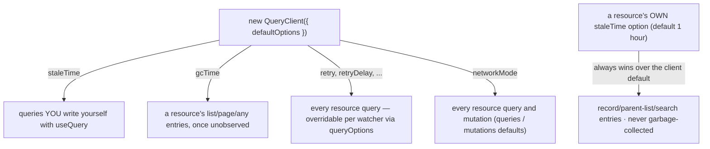
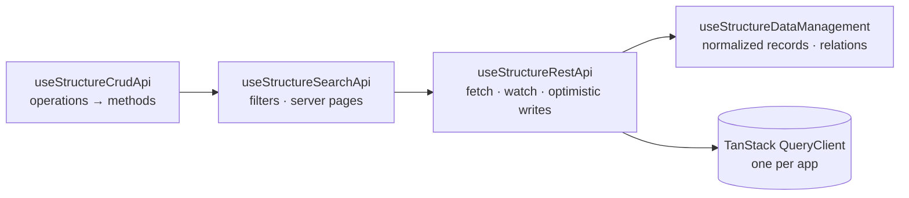

# Getting Started

`@guebbit/vue-toolkit` is a small set of Vue 3 composables and Pinia stores for building CRUD
screens: a normalized record store, a REST layer built directly on
[TanStack Query](https://tanstack.com/query) — one shared cache for records, lists, searches,
freshness and loading, with optimistic mutations and automatic rollback — Zod-backed form
validation, and two small Pinia stores (toasts, named loading flags).

## Install

```bash
npm install @guebbit/vue-toolkit @tanstack/vue-query pinia
```

### Peer dependencies

The package expects these already in your project:

| Package               | Version         |
| ---------------------- | --------------- |
| `vue`                 | `^3.4`          |
| `pinia`               | `^2.1 \|\| ^3 \|\| ^4` |
| `@tanstack/vue-query` | `^5.103`        |
| `zod`                 | `^4.4.3` (optional) |

`zod` is optional: only [`useStructureFormValidation`](/composables/structure-form-validation)
needs it, so install it (`npm install zod`) if you use that composable.

`pinia`'s floor is `2.1`, not `2.0`: building a resource inside a Pinia SETUP store (`defineStore('x', () => useStructureRestApi(...))`) relies on `useQueryClient()` finding the client `VueQueryPlugin` provided through Vue's injection — a setup store's own setup function did not run inside an injection context before `2.1`.

`@tanstack/vue-query` is a peer, not a regular dependency: install it yourself, once, and every
resource in your app shares the one `QueryClient` you create. Do **not** also install
`@tanstack/query-core` directly — `vue-query` depends on an exact version of it internally, and a
second copy at another version in your own `package.json` is a real failure (a client built from
the wrong copy silently never fetches).

### Runtime baseline

The package ships **ES2023** JavaScript (its `tsconfig` `target`), untranspiled and without
polyfills, and calls ES2023 built-ins such as `Array.prototype.toSorted`. That sets the floor
(versions from MDN's compatibility data for `toSorted`):

| Runtime                | Minimum              |
| ---------------------- | -------------------- |
| Chrome / Edge          | 110                  |
| Firefox                | 115                  |
| Safari (macOS and iOS) | 16                   |
| Node (SSR, tests)      | 22 (`engines.node`)  |

To support older browsers, have your bundler transpile `@guebbit/vue-toolkit` like your own code
and add the matching polyfills (core-js, say).

### App setup

```ts
import { createApp } from 'vue'
import { createPinia } from 'pinia'
import { QueryClient, VueQueryPlugin } from '@tanstack/vue-query'

const queryClient = new QueryClient({
    defaultOptions: {
        queries: { staleTime: 60 * 60 * 1000, gcTime: 60 * 60 * 1000, retry: false, networkMode: 'always' },
        mutations: { networkMode: 'always' }
    }
})

const app = createApp(App)
app.use(createPinia())
app.use(VueQueryPlugin, { queryClient })
```

Every `useStructureRestApi`/`useStructureSearchApi`/`useStructureCrudApi` call either takes this
client explicitly via its own `queryClient` option, or finds it through injection
(`useQueryClient()`, which also works inside a Pinia setup store). There is no private,
toolkit-owned client — one shared client per app is what makes cross-resource cache invalidation
possible at all. [Your first CRUD screen](/guide/first-crud-screen) builds a whole screen on top of
this setup.

What the client's `defaultOptions` reach:

- `staleTime`: only your own `useQuery` calls. A resource always sets its own (its `staleTime`
  option, 1 hour by default).
- `gcTime`: a resource's list, page and `any` entries, once nothing observes them (TanStack's
  default is 5 minutes in a browser). Records, parent lists and search pages never expire — see
  [cache lifetime](/composables/structure-rest-api#cache-lifetime).
- `retry`: every resource query. Unset, a `watch*` query retries a failure 3 times in a browser
  (so it reaches `error`/`onError` only after the retries) while a one-shot `fetch*` call does not
  retry; `retry: false` makes watchers report a failure at once too.
- `networkMode`: TanStack's default, `'online'`, pauses queries **and** mutations while the browser
  reports itself offline, and resumes them when it is back. `'always'` runs them regardless and
  lets them fail like any other request. Set it on both `queries` and `mutations`, as above, or an
  `updateOne` issued offline waits (its optimistic change already on screen) while the reads around
  it fail. Every option shown here is a choice, not a requirement: drop the ones you do not want.



A resource's records, parent lists and search pages never read `gcTime` at all — they live for
the `QueryClient`'s lifetime (or until a scope/`dependsOn` change removes them), regardless of what
the client default says. See [cache lifetime](/composables/structure-rest-api#cache-lifetime).

## What to use, and when

Start from [`useStructureCrudApi`](/composables/structure-crud-api): it declares a whole resource
from the API calls that reach it, and everything underneath stays reachable on the object it
returns. Drop to a lower layer only for what it does not wrap.



| You want…                                                                  | Use                                                                         |
| -------------------------------------------------------------------------- | --------------------------------------------------------------------------- |
| A whole resource: list, filtered search, read, create, update, delete      | [`useStructureCrudApi`](/composables/structure-crud-api) — **start here**    |
| Filtered, server-paginated search, wiring the calls yourself               | [`useStructureSearchApi`](/composables/structure-search-api)                 |
| One fetch, watcher or optimistic write at a time; parent relations; `fetchAny` | [`useStructureRestApi`](/composables/structure-rest-api)                 |
| A normalized, reactive record store for data you already have (no server)  | [`useStructureDataManagement`](/composables/structure-data-management)       |
| Form state, Zod validation, errors the server found                        | [`useStructureFormValidation`](/composables/structure-form-validation)       |
| A progress bar for one upload, with your own HTTP client                   | [`useUploadProgress`](/composables/upload-progress)                          |
| `data` / `error` / `loading` for one call that is not a resource           | [`useAsyncAction`](/composables/async-action)                                |
| A "the API is unreachable" banner                                           | [`useLivenessProbe`](/composables/liveness-probe)                            |
| "Is any of these resources busy?" across the app                           | [`useIsLoading`](/composables/is-loading)                                    |
| Loading flags for your own work that is not a request                      | [`useCoreStore`](/stores/core)                                               |
| Toasts, and messages that stay until the user deletes them                 | [`useNotificationsStore`](/stores/notifications)                             |

Each reference page documents the full API and the gotchas that matter in practice.
