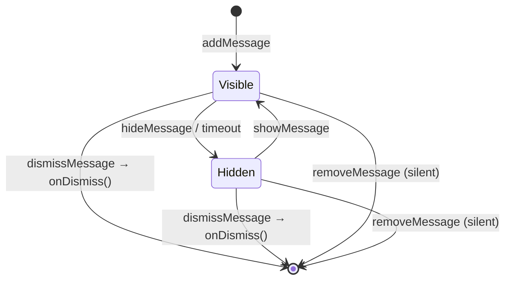

# useNotificationsStore

A Pinia store (id `'notifications'`) for toast-style messages, and for persistent ones that stay
until the user deletes them.

## Quickstart

```ts
import { useNotificationsStore, EToastType } from '@guebbit/vue-toolkit'

const notifications = useNotificationsStore()

// Show a toast that auto-hides after 4s
notifications.addMessage('Saved successfully', EToastType.SUCCESS, 4000)

// Render only the visible ones
notifications.messages // IToastMessage[]
```

## API

### Types

```ts
enum EToastType {
    PRIMARY = 'primary',
    SECONDARY = 'secondary',
    DANGER = 'error',
    WARNING = 'warning',
    SUCCESS = 'success'
}

interface IToastMessage {
    id: string
    message: string
    type: EToastType
    visible: boolean
    persistent: boolean
    createdAt: number
    meta?: Record<string, unknown>
}

interface IAddMessageOptions {
    id?: string                     // caller-owned id; a known id UPDATES that entry
    persistent?: boolean            // listed by persistentMessages regardless of visible; default false
    createdAt?: number              // epoch ms; default Date.now()
    meta?: Record<string, unknown>  // free payload for the renderer; the store never reads it
    onDismiss?: () => void | Promise<void> // called by dismissMessage only
}
```

### Messages (toasts)

| Property / method                          | Purpose                                                                                  |
| ---------------------------------------------- | ----------------------------------------------------------------------------------------------- |
| `history`                                   | Ref — every toast ever added, including hidden ones.                                     |
| `messages`                                  | Computed — only `visible: true` entries from `history`.                                  |
| `persistentMessages`                        | Computed — `history` filtered by `persistent`, newest `createdAt` first. Hidden ones are included. |
| `addMessage(message, type?, timeout?, options?)` | Adds a toast and returns its id. `type` defaults to `PRIMARY`. When `timeout > 0` (ms), it auto-hides via `hideMessage` after that delay; `0` or a negative value (the default `-1`) means no auto-hide — it stays visible until hidden or removed. Unrelated to `persistent`, which only decides whether `persistentMessages` lists it. `options` is `IAddMessageOptions`; see below. |
| `findMessage(id)`                           | Finds a toast in `history` by id.                                                        |
| `hideMessage(id)`                           | Sets `visible = false` — the toast stays in `history`.                                   |
| `showMessage(id)`                           | Sets `visible = true`.                                                                    |
| `dismissMessage(id)`                        | Async — the user is done with it: removes it from `history`, then calls its `onDismiss`. |
| `removeMessage(id)`                         | Permanently removes a toast from `history`, silently (no `onDismiss`).                   |

## Three verbs

Three ways a message goes away, with three different meanings:

| Verb                | Meaning                                                              | Leaves `history`? | Calls `onDismiss`? |
| ------------------- | -------------------------------------------------------------------- | ----------------- | ------------------ |
| `hideMessage(id)`    | Leaves the toast stack (close button, timeout)                       | no                | no                 |
| `dismissMessage(id)` | **The user** is done with it                                         | yes               | **yes**            |
| `removeMessage(id)`  | **The app** drops it (a sync found it gone at the source)            | yes               | no — no echo of a delete back to its source |



A persistent message typically arrives `Visible` (one toast), auto-hides to `Hidden`, and stays
listed in the app's panel (`persistentMessages`) until the user calls `dismissMessage`.

### Caller-owned ids

Pass `options.id` (a server row's id, say) and re-adding the same id **updates** that entry instead
of adding another: `message`, `type`, `persistent`, `meta` and `onDismiss` are replaced; `visible`
and `createdAt` are kept and the timeout is not re-armed. A refetch therefore never brings back a
toast the user already closed.

### Dismiss rolls back

`dismissMessage` removes the entry optimistically, then awaits `onDismiss`. If that rejects (or
throws), the entry goes back at its original index and the error is re-thrown — show it from the
caller. An unknown id resolves as a no-op. The callback is kept outside the reactive state, so
`history` stays serializable (devtools, SSR hydration).

## Recipes

The store stays agnostic: no HTTP, no storage. The app decides where a message comes from and where
a deletion goes.

### Server inbox

```ts
// on boot and on each refetch
for (const row of inbox) {
    notifications.addMessage(t(row.code, row.params), EToastType.PRIMARY, 4000, {
        id: row.id,
        persistent: true,
        createdAt: Date.parse(row.createdAt),
        onDismiss: () => api.delete(`/notifications/${row.id}`)
    })
}

// rows gone at the source: drop them silently, no DELETE echoed back
for (const { id } of notifications.persistentMessages)
    if (!inbox.some((row) => row.id === id)) notifications.removeMessage(id)

// the user clicks "delete" in the panel
notifications.dismissMessage(id).catch(showError)
```

### Local storage (guests)

Just another source: re-add on boot, with an `onDismiss` that clears the app's own storage.

```ts
for (const saved of readSavedMessages())
    notifications.addMessage(saved.text, saved.type, -1, {
        id: saved.id,
        persistent: true,
        createdAt: saved.createdAt,
        onDismiss: () => writeSavedMessages(readSavedMessages().filter(({ id }) => id !== saved.id))
    })
```

## Gotchas

- **`history` grows unbounded unless you call `removeMessage`.** `hideMessage` only toggles
  visibility — it doesn't free anything. If you want toasts to actually disappear from memory
  after they're hidden, call `removeMessage(id)` (you can do this in the same `setTimeout` you'd
  otherwise use for auto-hide, or right after `hideMessage`).
- **`addMessage`'s `timeout` default is `-1`** (no auto-hide: the toast stays visible until
  something hides it) — pass a positive number explicitly for toasts that hide themselves. This is
  about the toast only; whether a message stays listed after it is hidden is `persistent`'s job.

## See also

- [Getting Started](/guide/getting-started) — app setup and which composable to pick.
